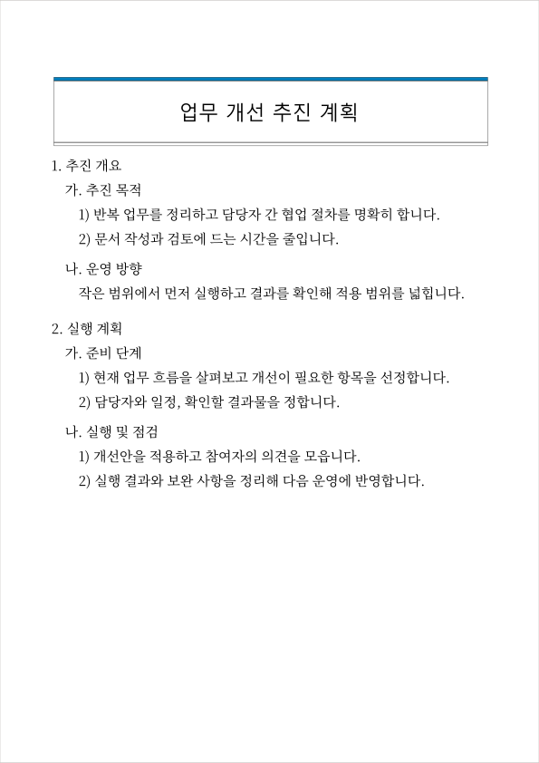
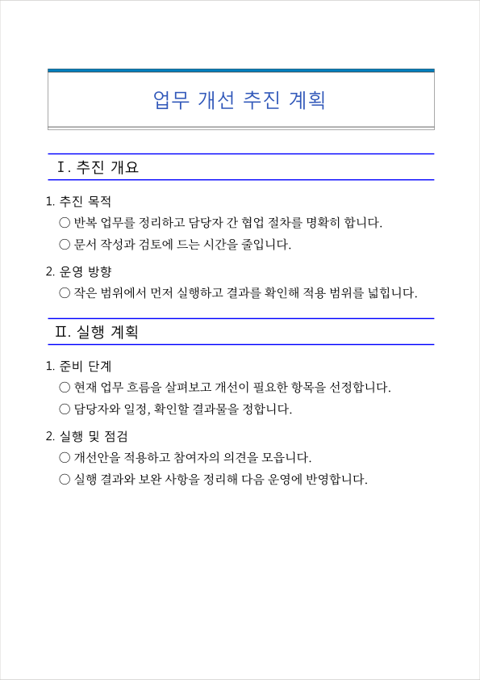

# HWPX Report Skills · 한글 보고서 스킬

**내용에 집중하세요. 번호·들여쓰기·문단 간격까지 갖춘 편집 가능한 한글 문서를 Codex로 만듭니다.**

새 보고서·계획서 작성부터 기존 양식 채우기·수정까지 지원합니다.
기관 지정 양식이 있으면 그 서식을 우선합니다.

## 원하는 디자인으로

| 디자인 | 구성 |
|---|---|
| **기본 보고서형** · 기본값 | 파란 제목 띠와 번호 중심 본문, 묶음별 문단 간격 |
| **섹션 구분형** | 두 단 제목과 로마숫자 섹션 상자, 숫자 소제목·글머리표 |

> 직원 교육 계획서를 **섹션 구분형**으로 한글 파일로 만들어 줘. $hwpx-create

같은 내용으로 만든 두 샘플을 비교해 보세요. 새 문서에서 스타일을 지정하지 않으면 선택을 안내합니다.

| 기본 보고서형 | 섹션 구분형 |
|---|---|
|  |  |
| [한글 샘플](examples/계획서_기본보고서형_업무개선_20261016.hwpx) | [한글 샘플](examples/계획서_섹션구분형_업무개선_20261016.hwpx) |

미리보기는 근사 렌더이며 이중선·그라데이션은 한글 실물과 다를 수 있습니다.
[스타일 추가 방법](skills/public-report-style/styles/README.md) · `--list-styles`로 목록 확인

## 설치

Python 3.10+, Node.js 18+, npm이 필요합니다.
[최신 릴리스](https://github.com/pinetreelic/hwpx-report-skills/releases/latest)의 ZIP을 풀고,
Codex에서 그 폴더를 열어 **“README를 읽고 네 스킬과 실행 도구를 설치해 줘”**라고 요청하세요.

직접 설치하려면 압축을 푼 폴더에서 실행합니다.

```sh
# macOS / Linux
python3 install.py --setup-runtime
# Windows
py -3 install.py --setup-runtime
```

기본 위치는 `~/.agents/skills`이며 같은 이름의 스킬은 덮어쓰지 않습니다.
실행 도구는 스킬 폴더 안에 격리 설치합니다. 설치 후 새 대화에서 사용하세요.

## 네 가지 스킬

| 스킬 | 할 수 있는 일 |
|---|---|
| `hwpx-create` | 새 한글(HWPX) 문서 만들기 |
| `hwpx-edit` | 기존 한글 문서 읽기·양식 채우기·수정 |
| `public-report-style` | 디자인 선택과 번호·제목·문단 스타일 적용 |
| `hwpx-to-office` | Word 변환, PPT 재구성, Excel 표 추출 |

- “이 내용을 **기본 보고서형**으로 만들어 줘. $hwpx-create”
- “이 양식에 내용을 채워 줘. 원본 서식은 유지해 줘. $hwpx-edit”
- “이 보고서를 Word로 변환해 줘. $hwpx-to-office”

## 알아둘 점

- 새 HWPX 생성·읽기·수정에는 한글 설치가 필요하지 않습니다. 글꼴은 별도 준비합니다.
- HWP 변환과 DOCX 출력은 Windows+한글이 필요합니다. PPT·Excel 출력은 별도 officecli가 필요합니다.
- 번호는 문자열과 문단 서식으로 구성됩니다. 편집 후 번호와 실제 페이지 배치를 확인하세요.
- SVG 미리보기는 근사입니다. [검증 범위](VERIFICATION.md)를 참고하세요.

관리·개선: [Sawyer Lee (@pinetreelic)](https://github.com/pinetreelic).
[hwpx-kit](https://github.com/6aneffy/hwpx-kit) 기반 · Apache-2.0.
원저작권과 재배포 고지는 [LICENSE](LICENSE)·[NOTICE](NOTICE)에 있습니다.
